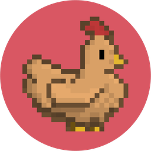
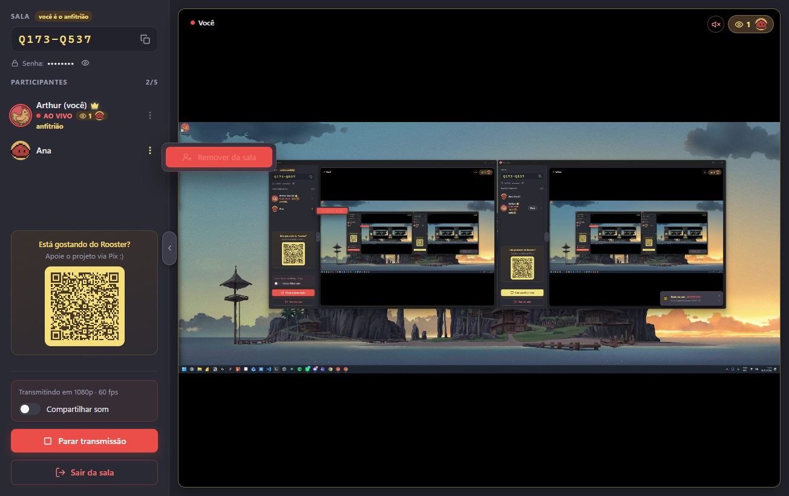
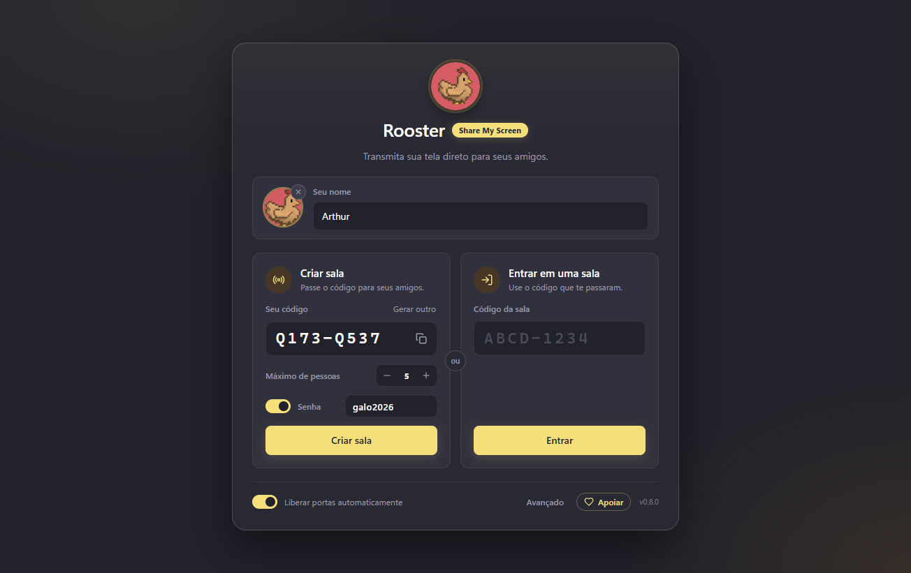
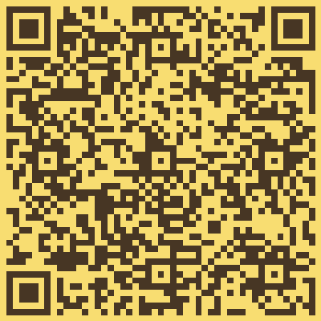

  

<h1 align="center">Rooster</h1>

  <b>Transmita sua tela direto para seus amigos.</b> 
  Leve, simples e sem cadastro.

  <a href="https://github.com/muryarth/rooster-screen-share-releases/releases/latest"><b>⬇️ Baixar para Windows</b></a>

  

## Por que o Rooster?

- 🖥️ **Tela ou janela, em alta qualidade.** Até 1080p a 60 fps.
- 🔊 **Com o som do PC, sem eco.** O app transmite o som dos jogos, vídeos e músicas, mas deixa de fora o Discord. Seus amigos não ouvem a própria voz de volta.
- 👀 **Todo mundo pode transmitir ao mesmo tempo.** Assista a várias telas lado a lado, fixe uma em destaque ou coloque em tela cheia.
- 🔒 **Direto entre vocês.** O vídeo vai de um PC para o outro, sem passar por servidores de terceiros.
- 🔑 **Sala com senha, se quiser.** Defina uma senha ao criar a sala; o anfitrião também pode remover quem não deveria estar lá.
- ⚡ **Leve para quem transmite.** O vídeo é codificado pela placa de vídeo quando possível, gastando pouca CPU.
- 🔑 **Sala com senha, se quiser.** Defina uma senha ao criar a sala; o anfitrião também pode remover quem não deveria estar lá.
- ⚡ **Leve para quem transmite.** O vídeo é codificado pela placa de vídeo quando possível, gastando pouca CPU.
- 🎟️ **Sem conta e sem cadastro.** Escolha um nome e uma foto, passe o código da sala e pronto.
- 🔄 **Sempre atualizado.** Quando sai uma versão nova, um clique atualiza e reinicia o app.

## Como usar

1. **Baixe e instale** o Rooster.
2. **Escolha seu nome** e, se quiser, uma foto.
3. **Crie uma sala** (com senha, se quiser) e mande o código para seus amigos, ou **entre** com o código de alguém.
4. Clique em **Compartilhar tela** para transmitir, ou em **Assistir** para ver a tela de um amigo.

Cada sala comporta até **5 pessoas** (o anfitrião pode ajustar de 2 a 10).

 
 

- O botão **⋯** ao lado de cada participante abre as opções: assistir, fixar, ocultar e, para o anfitrião, **remover da sala**.
- Em cada transmissão você vê quantas pessoas estão assistindo e um aviso quando quem transmite desligou o som.
- Quem está em outra rede (ou no 4G) consegue entrar mesmo assim: quem tiver as portas liberadas serve de ponte para os demais.

## Download

Na [página da última versão](https://github.com/muryarth/rooster-screen-share-releases/releases/latest), baixe um destes arquivos:

| Arquivo | Para quem |
|---|---|
| `Rooster-Setup-X.Y.Z.exe` | **Recomendado.** Instala o app com atalho no menu Iniciar. |
| `Rooster-Portable-X.Y.Z.exe` | Roda sem instalar. Bom para usar num pendrive. |

**Requisitos:** Windows 10 (versão 2004 ou mais recente) ou Windows 11, 64 bits.

> **O Windows mostrou "O Windows protegeu o computador"?** Isso é comum em apps novos. Clique em **Mais informações** e depois em **Executar assim mesmo**.

## Dicas

- **Amigo de outra cidade ou no 4G não conecta?** Na tela inicial, ligue **Liberar portas automaticamente**. O app abre as portas necessárias só enquanto você estiver numa sala. Basta que uma pessoa da sala consiga liberar as portas para todo mundo se conectar.
- **Todos precisam estar na mesma versão** do app. Se alguém não conseguir entrar, peça para atualizar.
- **Todos precisam estar na mesma versão** do app. Se alguém não conseguir entrar, peça para atualizar.
- **Se quem criou a sala sair**, ela passa para outra pessoa e todo mundo continua conectado.
- **`Ctrl +` e `Ctrl -`** aumentam ou diminuem o tamanho da interface.

## Apoie o projeto

**Está gostando do Rooster?**

O app é gratuito e feito com cuidado. Se quiser ajudar a mantê-lo, faça uma doação via Pix pelo QR Code ao lado. Ele também aparece dentro do app. Obrigado! 🐔💛

 

## Licença

Copyright © 2026 Arthur Azevedo Mury. Todos os direitos reservados.

Você pode baixar e usar o Rooster gratuitamente para uso pessoal e não comercial. Veja os termos completos em [LICENSE](LICENSE).
